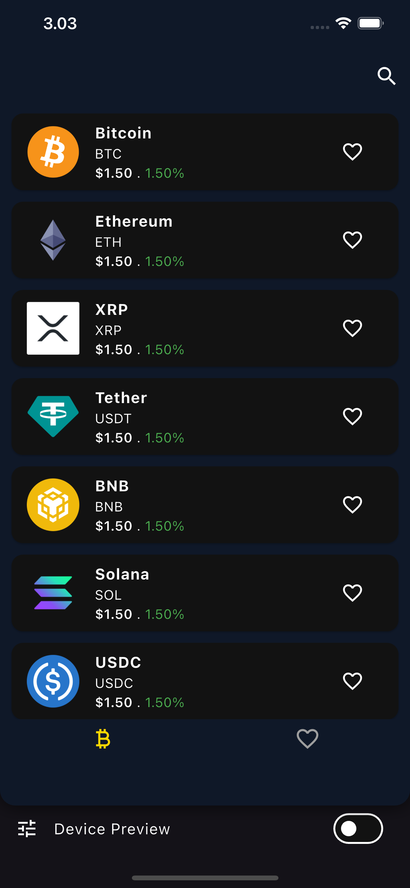
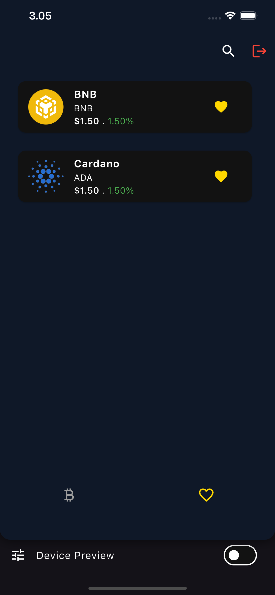
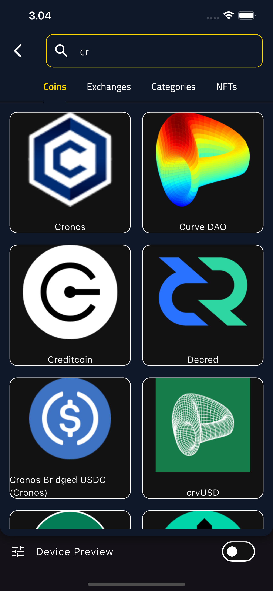
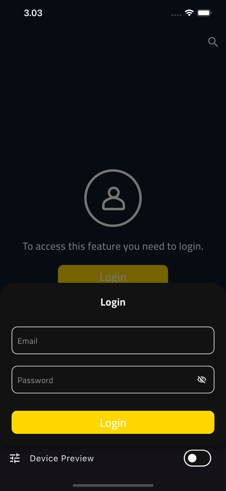

# Crypto Tracker — Flutter Sample

A Flutter cryptocurrency-tracking sample with search, a wishlist, local persistence, and mock authentication.

**Scope:** Login is mocked. Real API integration is future work; this project is not presented as a production financial service or a live market-data feed.

## Features

- Paginated cryptocurrency list
- Search across coins, categories, exchanges and NFTs
- Wishlist with a login-gated flow
- Login bottom sheet with mock authentication
- Local persistence using Isar

## Stack

| Area | Packages |
| --- | --- |
| State management | flutter_bloc |
| Networking | dio |
| Navigation | go_router |
| Local storage | isar, flutter_secure_storage |
| Dependency injection | get_it, injectable |
| Models | freezed, json_serializable, equatable |

## Screenshots






## Run locally

Use a Flutter SDK bundling Dart compatible with `^3.7.0`, plus platform tooling for your device. Isar dependencies use the community package host configured in pubspec.yaml.

```sh
git clone https://github.com/noura1812/crypto_tracker.git
cd crypto_tracker
flutter pub get
dart run build_runner build
flutter run
```

## Future work

- Real API integration
- Portfolio tracking
- Advanced charting

## Verification status

Build, tests, cache-refresh behavior and live connectivity have not been verified for this documentation update.

## Author

Noura — [GitHub](https://github.com/noura1812)
